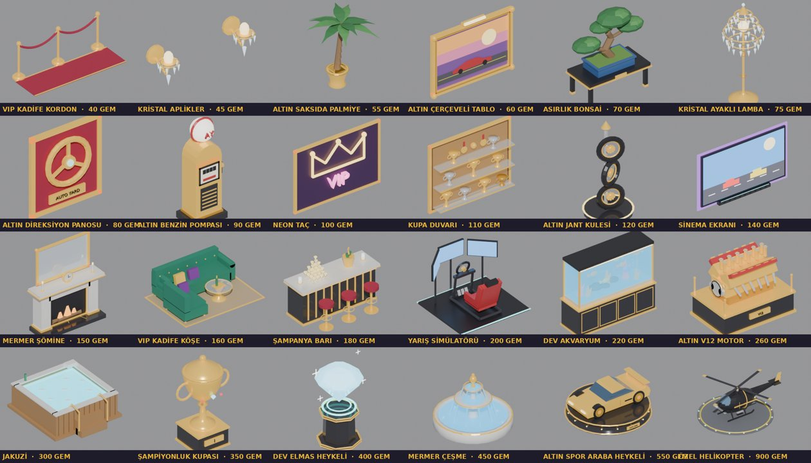
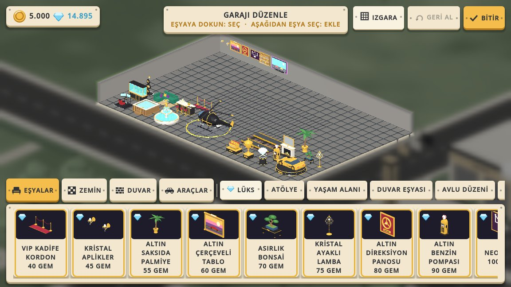
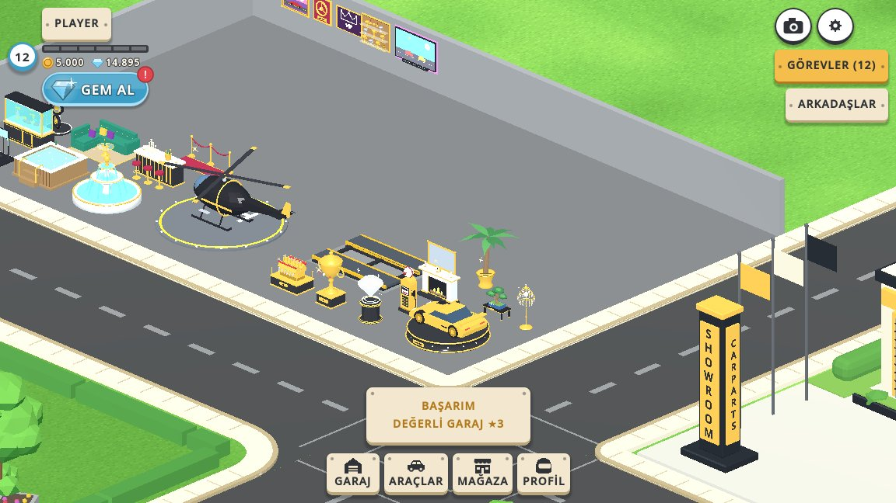

# LÜKS DEKOR: elmasla satılan 24 eşya

Tarih: 2026-10-15

## 1. Özet

Düzenleme paletinin EŞYALAR modunda yeni bir **LÜKS** sekmesi var. İçinde yalnızca elmasla satılan 24 eşya
duruyor: 18'i yere konuyor, 6'sı duvara asılıyor.

- Fiyat 40 ile 900 elmas arasında. Kartlar ucuzdan pahalıya dizili.
- Rütbe kilidi yok. Elmas ödenen değerdir; yeni oyuncu da ilk elmaslarıyla alabilir.
- Garaj değeri elmas başına 300 ₺. En pahalı eşya olan helikopter +270.000 ₺ ekliyor; ₺ kataloğunun en
  pahalısı 48.000 ₺ katkı yapıyor.
- Eşyalar gelir üretmez, v1'den beri süren karar değişmedi.

| Eşya | Elmas | Yer | | Eşya | Elmas | Yer |
|---|---|---|---|---|---|---|
| VIP kadife kordon | 40 | zemin | | Kristal aplikler | 45 | duvar |
| Altın saksıda palmiye | 55 | zemin | | Altın çerçeveli tablo | 60 | duvar |
| Asırlık bonsai | 70 | zemin | | Kristal ayaklı lamba | 75 | zemin |
| Altın direksiyon panosu | 80 | duvar | | Altın benzin pompası | 90 | zemin |
| Neon taç | 100 | duvar | | Kupa duvarı | 110 | duvar |
| Altın jant kulesi | 120 | zemin | | Sinema ekranı | 140 | duvar |
| Mermer şömine | 150 | zemin | | VIP kadife köşe | 160 | zemin |
| Şampanya barı | 180 | zemin | | Yarış simülatörü | 200 | zemin |
| Dev akvaryum | 220 | zemin | | Altın V12 motor | 260 | zemin |
| Jakuzi | 300 | zemin | | Şampiyonluk kupası | 350 | zemin |
| Dev elmas heykeli | 400 | zemin | | Mermer çeşme | 450 | zemin |
| Altın spor araba heykeli | 550 | zemin | | Özel helikopter | 900 | zemin |

Fiyatlar ekonomiye göre seçildi (docs/ELMAS_EKONOMISI.md): düzenli oyuncu günde yaklaşık 25–35 elmas
kazanıyor. Ucuz uç birkaç günde, orta kademe 1–2 haftada alınıyor. Pahalı uç (çeşme, araba heykeli,
helikopter) bir aylık birikim ya da gem paketi; 2.600'lük paketle helikopter ve iki heykel birlikte alınır.

## 2. Oyuncuya nasıl görünüyor

- **Sekme:** LÜKS sekmesinin yazısı elmas mavisi, solunda elmas ikonu var. Düzenleyici kendiliğinden bu
  sekmede açılmaz; depoda lüks eşya varsa açılır.
- **Kart:** koyu vitrin zemini, altın çerçeve, köşede elmas, altta "120 GEM".
- **Satın alma:** iki dokunuşla, ₺ eşyalardaki gibi. İlk dokunuşta "TEKRAR DOKUN: 900 GEM · GARAJ DEĞERİ
  +270.000 ₺" yazıyor.
- **Elmas yetmezse:** "GEM YETERSİZ · 450 GEM GEREKİYOR" yazıyor ve GEM MAĞAZASI açılıyor. Mağaza
  kapanınca düzenlemeye dönülüyor, kartlar elmas gelince kendiliğinden açılıyor.
- **Bakiye:** düzenleme ekranının sol üstündeki plakada para ile elmas birlikte görünüyor. Dar ekranda başlığa
  yer kalsın diye alt alta diziliyorlar.
- **Işıltı:** garajdaki lüks eşyaların üstünde ara ara küçük yıldızlar parlıyor. Bütün yıldızlar tek MultiMesh
  (tek çizim çağrısı); animasyon shader'da, kare başına betik işi yok. Düzenlerken gizli.

## 3. Teknik

- **Katalog:** `decor/decorations.json` dosyasında `kind: "luxury"`, `price: 0`, `price_gems`, `value` (₺)
  alanları var. `placement` açıkça yazılıyor (`floor` / `wall`).
- **Kod:**
  - `GarageDecor.Kind.LUXURY`, `gem_price()`, `is_gem_item()`.
  - `shop_order` aynı ₺ fiyatlı eşyaları elmas fiyatına göre dizer.
  - `DecorManager.can_purchase` / `purchase` lüks eşyada `PlayerProgress.spend_gems` kullanır; para değişmez.
    `purchase_failed` fiyatı eşyanın kendi biriminde yayar.
  - `GarageEditScreen.screen_requested(&"gem_store")` sinyalini HUD'daki UiRouter açar.
- **Kayıt:** değişmedi. Sahiplik eşya kimliğiyle tutulduğu için lüks eşya da aynı yoldan kaydedilip yükleniyor.
- **Modeller:** `tools/decor/props_v4_luks.py`, 344 ile 3.200 üçgen arası (ortalama ~1.600).
  - Dünyada ortam ışığı ve yansıma yok. Bu yüzden tam metal yüzey koyu görünüyor; altın düşük metallik,
    parlak taban rengi ve hafif ışımayla çiziliyor.
  - Işık veren parçalar (ateş, akvaryum suyu, neon, kristal) ışıma malzemesiyle yapıldı.
  - Yeniden üretmek için:
    `CT_DECOR_OUT=assets/decor blender --background --factory-startup --python tools/decor/run_bpy.py -- tools/decor/props_v4_luks.py`
    (`run_bpy.py` artık Blender ikilisinin `--` argümanlarını da kabul ediyor).
  - `.glb.import` ayarları eski dekorla aynı: `ensure_tangents=false`, `create_shadow_meshes=false`.
- **Işıltı:** `vfx/luxury_sparkles.gd` + `vfx/luxury_sparkle.gdshader`.
  - Billboard yıldızlar opak geometri. Görünüp kaybolma BOYUTLA yapılıyor; GL Compatibility'de gölgeli
    sahnedeki saydam dörtgen kare çiziliyordu.
  - `GarageDecorView.refresh()` / `set_editing()` yıldızları yeniden dağıtıyor.

## 4. Doğrulama

- `tests/luxury_decor_test.gd` (27 kontrol, run_tests.sh'de) şunları denetliyor:
  - Katalog en az 20 eşya içeriyor ve her eşyanın modeli, elmas fiyatı ve değeri var.
  - Elmas yetmezken hiçbir şey değişmiyor. Alımda elmas düşüyor, ₺ sabit kalıyor, garaj değeri artıyor.
  - ₺ eşya hâlâ parayla alınıyor.
  - Lüks eşya kayıttan geri geliyor.
  - Palette sekme ve kartlarda "GEM" fiyatı var; onay için iki dokunuş gerekiyor, elmas yetmeyince mağaza
    açılıp kapanınca düzenlemeye dönülüyor.
  - Işıltı lüks eşyada çıkıyor, düzenlerken gizleniyor.
- `garage_decoration_placement_test` ve `decor_test`'teki "fiyat > değer" kuralı ₺ eşyalarla sınırlandı.
  Elmaslı eşyada ₺ fiyatı 0 ve değeri > 0 olmalı. Duvar yerleşimine LÜKS kategorisi de izin veriyor.
- Görsel QA: `qa/luks_dekor_qa.gd`. Betik 24 eşyayı satın alıyor, garaja diziyor, her birinin oyun ışığında
  yakın planını çekiyor ve paleti / onayı / elmas yetmemesini gösteriyor.
  `CT_NO_TUTORIAL=1 tools/qa_isolated.sh res://qa/luks_dekor_qa.gd --display-driver x11 --disable-vsync --resolution 1152x648`
- Ekran taraması (`tools/ekran_tarama.sh -- dekor`) 16:9 telefonda, 4:3 tablette ve masaüstünde; Türkçe ve
  İspanyolca, 0 sorun.
- Çeviriler: 52 yeni metin `locale/en.json` / `es.json` dosyalarında, eksik 0.
