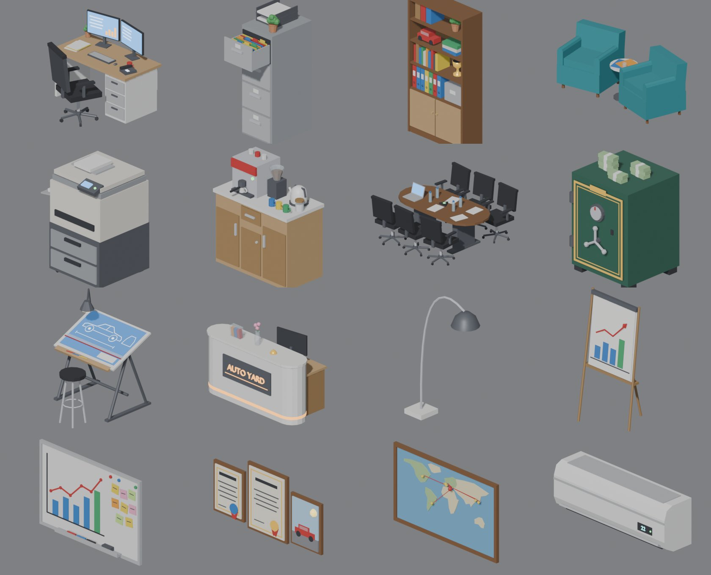
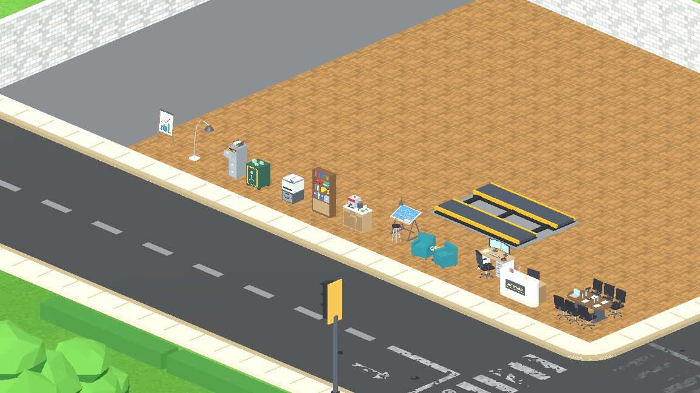
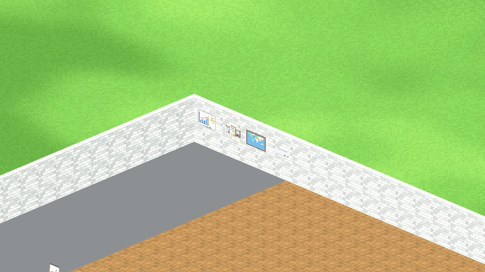
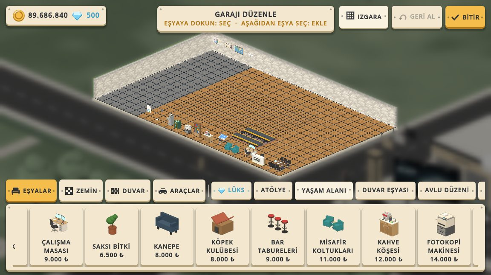

# OFİS DEKORU: garaja ofis kurmak için 16 eşya

Tarih: 2026-10-16

## 1. Özet

Garajda bir ofis köşesi kurmak için 16 yeni eşya eklendi: 12'si yere konuyor, 4'ü duvara asılıyor.

- Ayrı bir OFİS sekmesi açılmadı (kullanıcı kararı). Zemin eşyaları **YAŞAM ALANI** sekmesinde, duvar eşyaları
  **DUVAR EŞYASI** sekmesinde duruyor. Duvara asılan her eşya bu sekmede toplanıyor; bu, eski kuraldır ve
  `garage_decoration_placement_test` bunu denetliyor.
- Fiyatlar 3.500 ile 32.000 ₺ arasında. Garaj değerine katkı fiyatın %40'ı; eşyalar gelir üretmiyor.
- 7 eşya rütbe 1'de açık, yani yeni oyuncu ofisini hemen kurmaya başlayabilir. Büyük parçalar (toplantı masası,
  karşılama bankosu) rütbe 3–4'te açılıyor.
- Toplam bedel 187.500 ₺, garaj değerine katkısı 75.000 ₺.

| Eşya | Fiyat | R | Sekme | İçerik |
|---|---|---|---|---|
| Sunum panosu | 3.500 | 1 | Yaşam alanı | Satış grafiği çizilmiş kâğıtlı sehpa |
| Dosya dolabı | 4.000 | 1 | Yaşam alanı | 4 çekmeceli çelik dolap, üst çekmece açık, renkli dosyalar |
| Ayaklı lamba | 4.500 | 1 | Yaşam alanı | Mermer ayaklı, kavisli okuma lambası (ışıklı) |
| Kitaplık | 7.500 | 1 | Yaşam alanı | Klasörler, kitaplar, kupa, maket araba |
| Çalışma masası | 9.000 | 1 | Yaşam alanı | Çift monitör, klavye, kupa, telefon, ofis koltuğu |
| Misafir koltukları | 11.000 | 2 | Yaşam alanı | İki kumaş koltuk ve dergili yan sehpa |
| Kahve köşesi | 12.000 | 2 | Yaşam alanı | Espresso makinesi, öğütücü, kettle, kupalar |
| Fotokopi makinesi | 14.000 | 2 | Yaşam alanı | Kâğıt çekmeceli, ekranlı büyük ofis fotokopisi |
| Çelik kasa | 18.000 | 3 | Yaşam alanı | Şifre kadranı, çark kolu, üstünde banknot desteleri |
| Çizim masası | 20.000 | 3 | Yaşam alanı | Eğik masada araba projesi, lamba, tabure |
| Toplantı masası | 26.000 | 3 | Yaşam alanı | Ceviz masa, 6 koltuk, dizüstü, su şişeleri |
| Karşılama bankosu | 32.000 | 4 | Yaşam alanı | Işıklı AUTO YARD yazısı, servis zili, broşürler |
| Belge çerçeveleri | 4.500 | 1 | Duvar eşyası | İki mühürlü belge ve bir araba fotoğrafı |
| Beyaz tahta | 5.500 | 1 | Duvar eşyası | Yükselen grafik, yapışkan notlar, kalemler |
| Klima | 7.000 | 2 | Duvar eşyası | Split klima, ekranında 22 |
| Dünya haritası | 9.000 | 2 | Duvar eşyası | İğne ve iple işaretli araç ithalat rotaları |

## 2. Oyunda

Palet kartları rütbe, sonra fiyat sırasında dizildiği için ucuz ofis eşyaları YAŞAM ALANI'nda eski eşyaların
arasına karışıyor (örnek: ÇALIŞMA MASASI 9.000 ₺, KANEPE 8.000 ₺'nin yanında).

## 3. Teknik

- **Katalog:** `decor/decorations.json` dosyasına 16 kayıt eklendi. Zemin eşyaları `kind: "lounge"`, duvar
  eşyaları `kind: "wall_item"`. Yerleşim türü (`placement`) açıkça yazıldı. Başka kod değişmedi.
- **Modeller:** `tools/decor/props_v5_ofis.py`. Modeller 250 ile 2.100 üçgen arasında, toplam 1,1 MB glb.
  - Eşyalar gerçek ölçüde çizildi: masa 1,50 m, kitaplık 1,90 m, toplantı masası koltuklarıyla 2,20 × 2,38 m.
  - Yeni `local()` yardımcısı parçaları birlikte döndürüyor. Ofis koltuğu bir kez çiziliyor; çalışma masasında ve
    toplantı masasında (6 adet) döndürülerek kullanılıyor. Çizim masasının eğik panosu da bu yardımcıyla kuruluyor.
  - Dünyada ortam ışığı yok. Bu yüzden metaller düşük metallikle çizildi; ekran, lamba ve banko yazısı ışıma
    malzemesi kullanıyor.
  - Klima beyaz duvarda kayboluyordu. Gri alt gövde ve ışık şeridi eklendi.
  - Yeniden üretmek için:
    `CT_DECOR_OUT=assets/decor blender --background --factory-startup --python tools/decor/run_bpy.py -- tools/decor/props_v5_ofis.py`
  - `.glb.import` ayarları eski dekorla aynı: `ensure_tangents=false`, `create_shadow_meshes=false`.
- **Çeviri:** 32 yeni metnin (16 başlık, 16 açıklama) İngilizce ve İspanyolca karşılığı `locale/en.json` ve
  `locale/es.json` dosyalarında.

## 4. Doğrulama

- `tests/office_decor_test.gd` (başsız, run_tests.sh'ye eklendi) şunları denetliyor:
  - Katalog: tür, yerleşim türü, fiyat, %40 değer, rütbe ve açıklama.
  - Modeller: model var, üçgen sayısı en çok 3.500, ölçüler gerçek metrede makul.
  - Çeviri: İngilizce ve İspanyolca karşılıklar var.
  - Garaj: her zemin eşyası boş bir yere konuyor, her duvar eşyası arka duvara yaslı asılıyor.
  - Palet: kartlar doğru sekmelerde.

  Bu test henüz koşulmadı. Tam paket kullanıcı "testi başlat" deyince koşulacak.
- Görsel QA: `qa/ofis_dekor_qa.gd`. Betik rütbe 10'da örgü parke zemin ve beyaz tuğla duvar kuruyor, 16 eşyanın
  hepsini yerleştiriyor ve palet sekmelerini çekiyor. Sonuç: hata yok.
