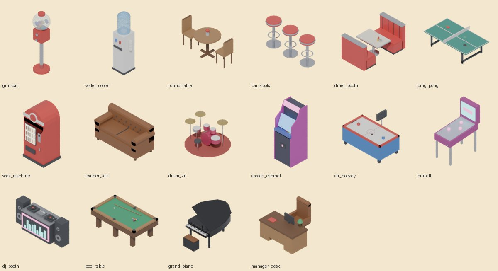
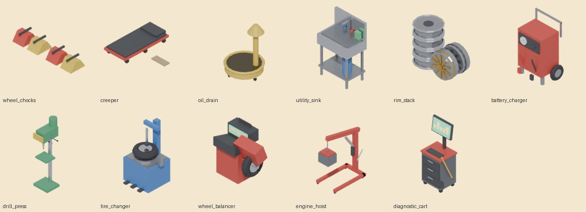
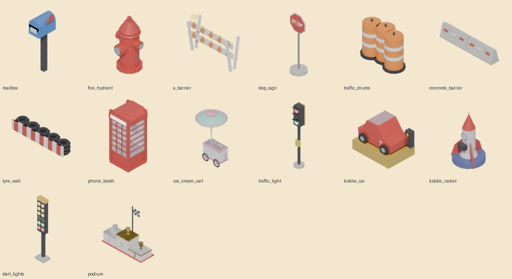
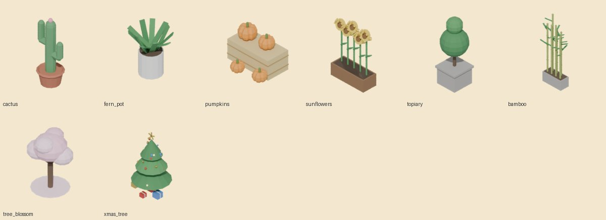
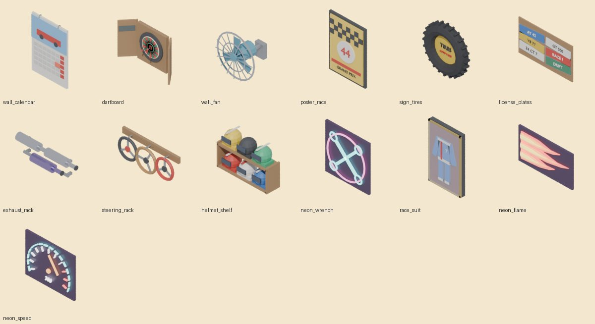
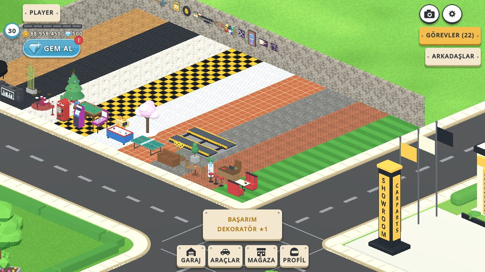
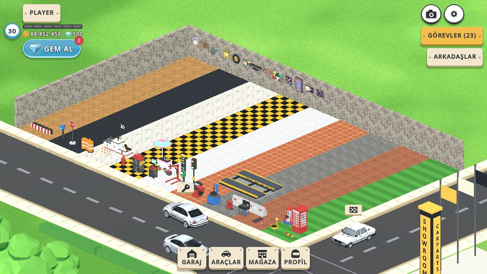
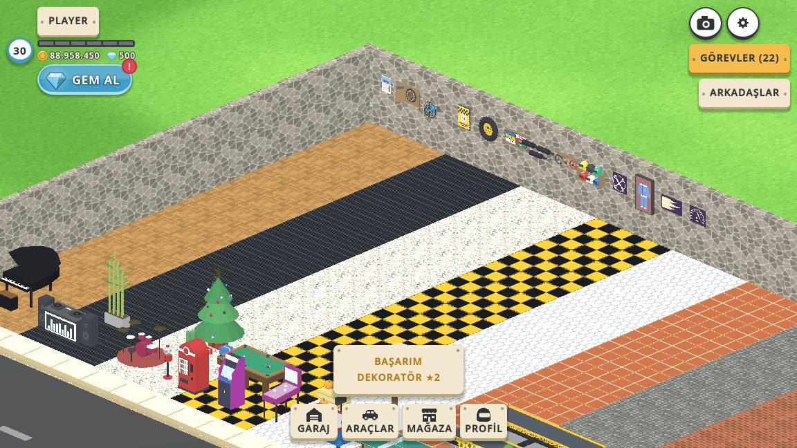
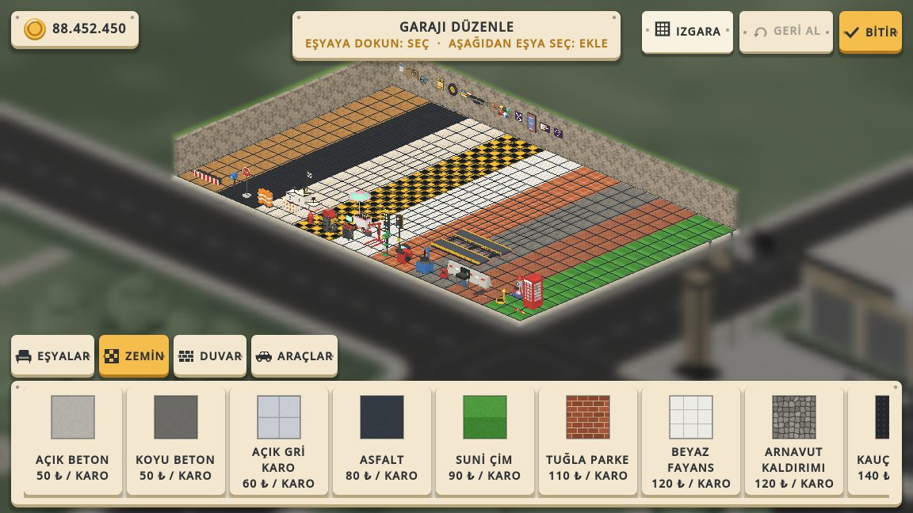

# DEKORASYON v3: katalog yaklaşık 1,5 katına çıktı

Tarih: 2026-10-13 · Kaynak araştırma: `docs/DEKORASYON_V2_ARASTIRMA.md` §3.5 (orijinal Car Town kataloğu)

## 1. Özet

| | v2 | v3 | Artış |
|---|---|---|---|
| Aktif eşya | 144 | **223** | **+79 (×1,55)** |
| Yerleştirilen eşya (zemin + duvar) | 97 | 159 | +62 Blender modeli |
| Zemin deseni | 24 | 34 | +10, kodla üretilir |
| Duvar kaplaması | 17 | 24 | +7, kodla üretilir |

Kod tarafında üç küçük değişiklik var:

- Desen başına değerlerin dizisi 32'den 64'e çıktı (`vfx/floor_tiles.gdshader`, `GarageDecorView.MAX_PATTERNS`).
  Yeni desenlerle sayı 34 oldu ve eski sınırı aştı.
- Palet kartları rütbe kilidine, sonra fiyata göre diziliyor (`GarageDecor.shop_order`). 40 kartlı bir sekmede
  oyuncu ucuz ve açık eşyayı önce görür. Desen katmanlarının sırası değişmedi; kayıt desen id'si tuttuğu için
  sıra zaten serbest.
- `tools/decor/kit.py` içinde `prism()` eklendi: 2B dış hattı ekstrüde eder (piyano gövdesi, atari yan paneli,
  beton bariyer profili). Çıktı klasörü `CT_DECOR_OUT` ile değiştirilebilir.

Eşya gelir üretmez, v2'deki karar korundu: ödenen paranın %40'ı garaj değerine yazılır.

## 2. Orijinal oyundan ne alındı

Orijinal Car Town'un Misc, Chairs & Tables ve Functional sekmeleri (araştırma belgesi §3.5) bizde eksik olan
iki büyük grubu gösterdi:

1. Eğlence eşyaları: atari, pinbol, air hockey, soda makinesi, telefon kulübesi ve çocuk binekleri (araba,
   uzay gemisi).
2. Müzik köşesi: davul, DJ masası, kuyruklu piyano.

Bunlara ek olarak orijinalden şunlar geldi:

- **Oturma:** diner koltuğu, bar taburesi, yuvarlak masa, deri kanepe, masa tenisi. "Kaptan koltuğu ve masası"
  orijinalin 10.000 altınlık lüks ucuydu; bizde MÜDÜR MASASI oldu.
- **Misc sekmesi:** lavabo, park takozu, dur levhası, ayaklı trafik lambası, yarış başlangıç ışıkları, şeritli
  variller, A tipi ve beton bariyer, vitrinde yarış tulumu.
- **Sezonluk eşyalar:** orijinalde süreli satılırdı ("Expired on November 1, 2010"). Bizde BALKABAKLARI ve
  YILBAŞI AĞACI her mevsim satılıyor; süreli satış altyapısı yok.

Gerçek tamirhane ekipmanı bu çekirdeği tamamlar: lastik sökme, balans, motor vinci, sütunlu matkap, arıza
tespit, akü şarj, sürüngeç, yağ boşaltma kabı ve jant yığını.

Not: Bu oturumda fandom wiki ağ politikası yüzünden kapalıydı; web aramaları yalnızca işlevli eşyaları
doğruladı (örnek: Kiddie Spaceship). Kataloğun ayrıntısı v2 araştırma belgesindeki wiki tablolarından geliyor.

## 3. Yeni eşyalar

Fiyat ₺ cinsinden; garaj değeri fiyatın %40'ı. "R" rütbe kilididir. Zemin desenlerinde fiyat göz başınadır.

### Yaşam alanı (16)
| Eşya | Fiyat | R | | Eşya | Fiyat | R |
|---|---|---|---|---|---|---|
| Sakız makinesi | 3.000 | 1 | | Davul seti | 28.000 | 4 |
| Su sebili | 4.000 | 1 | | Atari makinesi | 32.000 | 4 |
| Yuvarlak masa | 7.000 | 1 | | Air hockey | 38.000 | 4 |
| Bar tabureleri | 9.000 | 2 | | Pinbol | 42.000 | 5 |
| Diner koltuğu | 18.000 | 3 | | DJ masası | 55.000 | 6 |
| Masa tenisi | 20.000 | 3 | | Bilardo masası | 60.000 | 6 |
| Gazoz makinesi | 22.000 | 3 | | Kuyruklu piyano | 90.000 | 7 |
| Deri kanepe | 24.000 | 4 | | Müdür masası | 100.000 | 8 |



### Atölye (11)
| Eşya | Fiyat | R | | Eşya | Fiyat | R |
|---|---|---|---|---|---|---|
| Teker takozları | 1.800 | 1 | | Sütunlu matkap | 15.000 | 3 |
| Sürüngeç | 2.200 | 1 | | Lastik sökme makinesi | 19.000 | 3 |
| Yağ boşaltma kabı | 2.800 | 1 | | Balans makinesi | 21.000 | 3 |
| Atölye lavabosu | 6.500 | 1 | | Motor vinci | 27.000 | 4 |
| Jant yığını | 7.000 | 2 | | Arıza tespit cihazı | 36.000 | 5 |
| Akü şarj arabası | 8.000 | 2 | | | | |



### Avlu düzeni (14)
| Eşya | Fiyat | R | | Eşya | Fiyat | R |
|---|---|---|---|---|---|---|
| Posta kutusu | 2.500 | 1 | | Telefon kulübesi | 24.000 | 4 |
| Yangın musluğu | 3.000 | 1 | | Dondurma arabası | 26.000 | 4 |
| A tipi bariyer | 3.500 | 1 | | Trafik lambası | 30.000 | 4 |
| Dur levhası | 3.500 | 1 | | Çocuk arabası | 34.000 | 5 |
| Trafik varilleri | 4.200 | 1 | | Uzay gemisi bineği | 48.000 | 6 |
| Beton bariyer | 6.500 | 2 | | Start ışıkları | 70.000 | 6 |
| Lastik bariyer | 9.500 | 2 | | Yarış kürsüsü | 95.000 | 7 |



### Bitki (8)
Kaktüs 4.000 (R1) · eğrelti saksısı 4.500 (R1) · balkabakları 5.000 (R2) · ayçiçekleri 6.000 (R2) ·
top şimşir 8.000 (R2) · bambu 14.000 (R3) · sakura 32.000 (R5) · yılbaşı ağacı 40.000 (R5)



### Duvar eşyası (13)
Takvim 2.500 (R1) · dart tahtası 4.500 (R1) · duvar vantilatörü 5.500 (R1) · yarış posteri 7.500 (R1) ·
lastik tabelası 8.000 (R2) · plaka kolajı 9.500 (R2) · egzoz askısı 14.000 (R3) · direksiyon askısı 16.000 (R3) ·
kask rafı 22.000 (R4) · neon anahtar 30.000 (R4) · yarış tulumu 30.000 (R5) · neon alev 40.000 (R5) ·
neon hız göstergesi 50.000 (R6)



### Zemin deseni (10, göz başına)
Suni çim 90 (R1) · tuğla parke 110 (R1) · Arnavut kaldırımı 120 (R2) · terakota karo 140 (R2) ·
altıgen karo 180 (R2) · sarı dama 180 (R2) · terazzo 230 (R3) · çelik ızgara 240 (R3) · örgü parke 260 (R4) ·
mermer 300 (R4)

### Duvar kaplaması (7)
Yarış yeşili 8.000 (R1) · turuncu boya 8.000 (R1) · brüt beton 10.000 (R2) · beyaz tuğla 11.000 (R2) ·
taş duvar 20.000 (R4) · şeritli duvar 24.000 (R4) · elmas sac duvar 26.000 (R5)

Yeni toplam bedel 1.518.000 ₺ (zemin desenleri hariç); garaj değerine katkısı 607.200 ₺. Rütbe kilidinin
dağılımı geç oyunu da besliyor: 16 eşya R5 ve üstünde.

## 4. Üretim

### Modeller

| Parti | Dosya | Eşya |
|---|---|---|
| Yaşam alanı | `tools/decor/props_v3_salon.py` | 16 |
| Atölye | `tools/decor/props_v3_atolye.py` | 11 |
| Avlu | `tools/decor/props_v3_avlu.py` | 14 |
| Bitki | `tools/decor/props_v3_bitki.py` | 8 |
| Duvar | `tools/decor/props_v3_duvar.py` | 13 |

Kurallar `kit.py` ile aynıdır: ölçü metre, ön yüz −Y, orijin tabanın ortasında. Modeller 100–3.000 üçgen
arasında, ortalama 52 KB glb (v2 ortalaması 31 KB). Yazılar dilden bağımsızdır: STOP, rakamlar, plaka metni
ve kurgusal marka AUTO YARD. Gerçek marka yoktur. Harf kıvrımları kabadır (`resolution_u = 3`); plaka
kolajının üçgen sayısı bununla 8.300'den 2.900'e indi.

Blender açmadan yeniden üretmek için:

```
pip install bpy   # Blender 5.x modülü
CT_DECOR_OUT=assets/decor python tools/decor/run_bpy.py tools/decor/props_v3_salon.py [...]
CT_DECOR_ONLY=pinball,jukebox ...   # yalnız bu adları dışa aktarır (hızlı deneme)
```

Açık Blender oturumunda canlı üretmek için eski yol aynen çalışır:
`python3 tools/decor/blender_send.py --kit <parti>`.

`.glb.import` dosyalarının ayarları eskilerle aynı tutuldu: `ensure_tangents=false` ve
`create_shadow_meshes=false`.

### Desenler (`vfx/decor_textures.gd`)

Hepsi 128 px'lik, kenardan kenara ek yeri vermeyen dokular:

- Taş döşeme ve taş duvar: sarmal (toroidal) Voronoi; her taşın kendi tonu ve kenar pahı var.
- Altıgen karo: kaydırmalı altıgen kafes.
- Mermer: karo boyunun katı frekanslarda bükülmüş damarlar.
- Terazzo: rengârenk kırıntılar.
- Çelik ızgara: lama ve çapraz çubuklar.
- Örgü parke: 2 × 2 blokta yatay ve düşey latalar.
- Brüt beton: kalıp tahtası izleri ve bağlantı delikleri.
- Şeritli duvar: kırmızı-beyaz-kırmızı yatay bant.

Tuğla parke, terakota, sarı dama, beyaz tuğla ve elmas sac duvar mevcut yardımcıları kullanır.

## 5. Doğrulama

`tests/decor_v2_test.gd`'ye "10) DEKORASYON v3 KATALOĞU" bölümü eklendi; testte 81 kontrol var, hepsi geçti.
Yeni bölüm şunları denetler:

- Katalog en az 216 eşya.
- Desen sayısı shader'ın dizisine sığıyor (34 / 64).
- Her desenin kendi dokusu, her kaplamanın kendi rengi var.
- Yerleştirilen her eşyanın gövdesi var.
- Her sekmede kartlar rütbe, sonra fiyat sırasında.

`garage_decoration_placement_test` (165) ve `locale_test` (29) de geçti. 158 yeni metnin İngilizce ve
İspanyolca çevirisi `locale/en.json` ve `locale/es.json`'da; eksik çeviri sıfır.

Görsel QA için `qa/dekor_v3_qa.gd` çalıştırıldı. Betik gerçek Main.tscn'de, rütbe 10'da şunları yapar:

- 10 deseni şerit şerit boyar ve taş duvarı uygular.
- 13 duvar eşyasını asar.
- 62 zemin eşyasını iki turda yerleştirir; hepsi geçerli bir yer buldu.
- Palet sekmelerini çeker.





