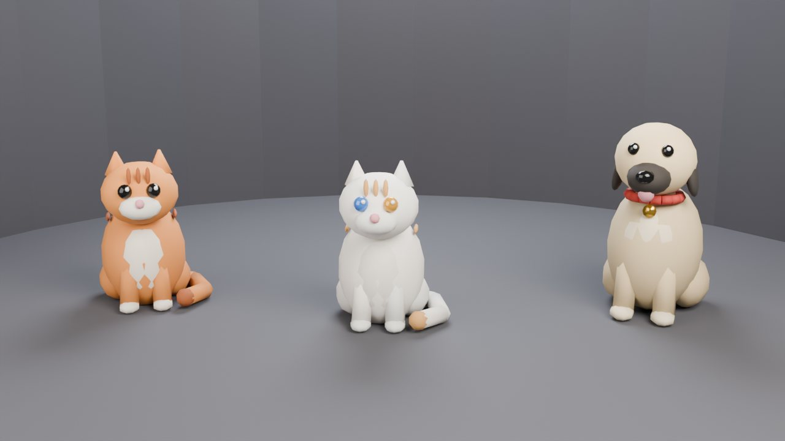
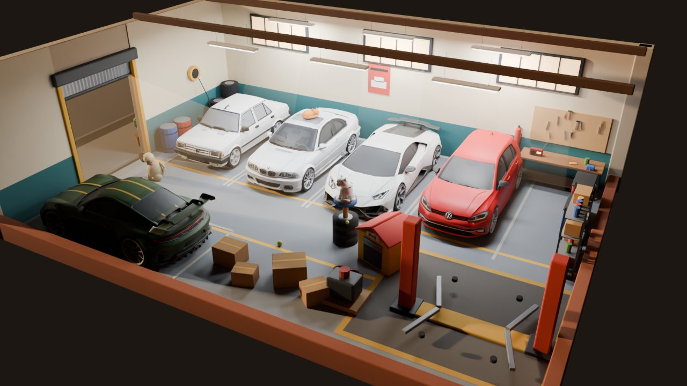
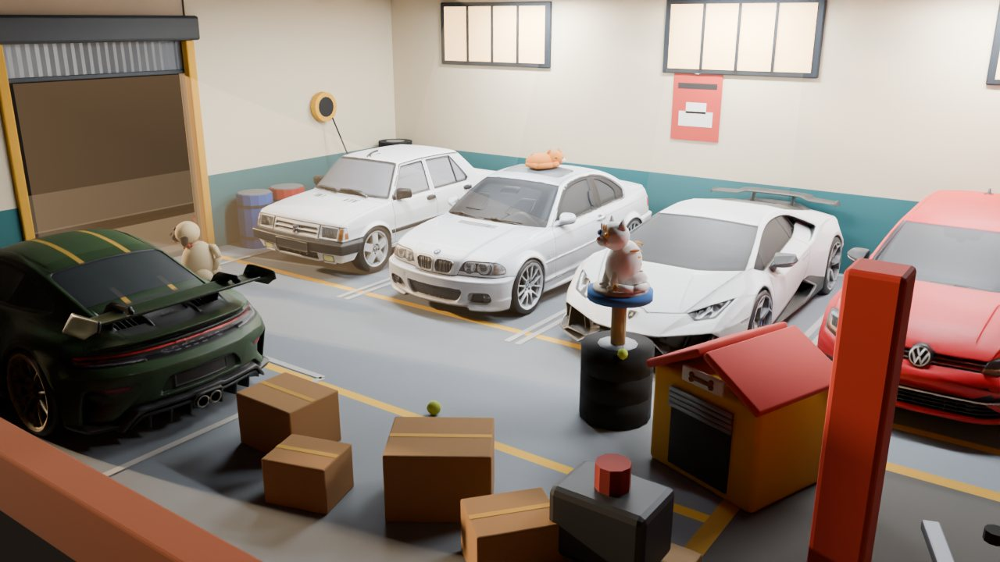

# Evcil Hayvan Raporu — "Garaj Dostları"

Hazırlanma: 22 Ekim 2026 · Durum: **öneri** (kod yazılmadı) · Konsept çizimleri: `tools/pets/pet_concepts.py`

## 1. Kısaca

Oyuna garajda yaşayan, sevilebilen, arabaların üstünde uyuyan **evcil hayvanlar** ekleyelim. Önerim:

- **İlk hayvan ücretsiz bir mahalle kedisi (Tekir).** Rıza Usta'nın erken bir dersinde garaja kendiliğinden gelir, oyuncu ona ad verir.
- **Bakım yükü yok, ceza yok.** Hayvan acıkıp kaçmaz, hastalanmaz, ölmez. Günde birkaç kez sevmek küçük, sınırlı bir ödül verir.
- **Önce kozmetik, sonra küçük işlevler.** Kedi araç tavanında uyur, köpek müşteriyi karşılar. Bonuslar küçük ve hep olumlu.
- **Rastgele kutudan hayvan çıkmaz.** Hayvanlar seviyeyle, görevle, etkinlikle ya da doğrudan satın alınarak kazanılır (Play politikası ve Türkiye'deki yeni düzenleme, §9).
- **Sosyal görünürlük.** Arkadaş ziyaretinde hayvanın görünür, arkadaşın onu günde bir kez sevebilir, OTO MANŞET'te haber olur.

Neden şimdi: oyun dünyası buna hazır. MAHALLE garajında zaten uyuyan bir kedi, hurdalıkta Necati'nin bekçi köpeği, dekor kataloğunda boş bir köpek kulübesi var. Araştırdığım mobil garaj oyunlarında bir garaj kedisi veya köpeği maskotu bulamadım, yani bu türde ayırt edici olur (§3).



*Konsept: oyunun yumuşak, çizgi film diliyle üç hayvan. Soldan: **Tekir** (turuncu tekir), **Van Kedisi** (beyaz, bir gözü mavi bir gözü kehribar), **Karabaş** (Kangal tipi; siyah maske, kırmızı tasma, altın künye).*

## 2. Neden işe yarar

- **Kültürel uyum.** İstanbul'un sokak kedileri mahallece beslenir ve "arkadaş" gibi görülür. *Kedi* belgeseli bunu dünyaya anlattı ([kaynak](https://www.mentalfloss.com/article/91887/kedi-heartwarming-new-documentary-stars-istanbuls-street-cats)). Türk oyuncu için "sanayideki kedi" anında tanıdık gelir.
- **Bağlılık.** Ticari oyunlarda evcil hayvanın tutundurmaya etkisini gösteren açık bir veri yok. Kontrollü tek veri sağlık alanından: sigara bırakma uygulamasına eklenen özelleştirilebilir ejderha, kullanımı %20, ana araçların kullanımını %30 artırdı ([BU](https://www.bu.edu/sph/?p=246609), [JMIR makalesi](https://www.jmir.org/2024/1/e57839)). Bu yüzden özelliği bir kontrol grubuyla ölçmeyi öneriyorum (§12).
- **Gelir.** Playrix (Homescapes / Gardenscapes) sezon biletlerinin vitrin ödülü çoğu zaman yeni bir evcil hayvandır ([kaynak](https://apkmirror.com/apk/playrix/homescapes/homescapes-7-2-5-release), [kaynak](https://www.liquidandgrit.com/wp-content/uploads/2020/01/Puzzle-Report-January-2020.pdf)). Hay Day'de hayvanlar ve aksesuarları ücretli bilete bağlı ([kaynak](https://apkmirror.com/apk/supercell/hay-day/hay-day-1-52-125-release)).
- **Dekora talep.** Hayvanın sevdiği eşya (yatak, kule, kulübe) yerleştirilince hayvan oraya gelir. Bu, baskı kurmadan dekor satışı yaratır (Neko Atsume ve Pocket Camp örneği, [kaynak](https://dailydot.com/neko-atsume-cat-collecting-guide), [kaynak](https://www.pocketgamer.biz/how-does-animal-crossing-pocket-camp-monetise/)).

## 3. Diğer oyunlardan dersler

| Oyun | Ne yapıyor | Bize dersi |
|---|---|---|
| Pokémon GO (arkadaş) | Sevgi kalpleri yürüme, besleme, oyun, fotoğraf ile; her kaynağın **günlük sınırı** var; "heyecanlı" iken ×2 ([kaynak](https://pokemongohub.net/post/user-guide/go-hub-guide-to-buddy-interactions-in-pokemon-go/)) | Sevme ödülü günlük sınırlı olsun, oyuncuyu sömürmesin |
| Nintendogs | Köpek acıkır, kirlenir; ama "bir kap mama, bir banyo… her şey affedilir"; ağır ihmalde kaçar, ölmez ([kaynak](https://www.gamesradar.com/nintendogs-review)) | Bağışlayıcı tasarım: biz kaçmayı da koymuyoruz |
| Tamagotchi tarzı | Tek bakım kaçırınca ölüm "aşırı" bulunuyor, oyuncu daha yumuşak oyunlara kaçıyor ([kaynak](https://www.virtualpetlist.com/threads/worst-virtual-pet-designs-or-mechanics-what-doesnt-work.3080/)) | Suçluluk döngüsü kurma |
| Coin Master | İşlevsel hayvanlar; mama gerçek parayla satılıyor, darboğaz oluyor ([kaynak](https://en.wikipedia.org/wiki/Coin_Master), [ikincil](https://levvvel.com/coin-master/pets/)) | Mamayı ödeme duvarı yapma |
| Hay Day | Köpek / kedi evleri; mama → 6 saatte bir XP ([ikincil](https://www.supercheats.com/hay-day/walkthrough/list-of-pets)) | Küçük, düzenli, olumlu bonus |
| Neko Atsume | Mama ve oyuncak koyarsın, kediler uygulama kapalıyken gelir, hatıra bırakır; kedi albümü ([kaynak](https://thespinoff.co.nz/culture/13-11-2015/gaming-this-week-i-played-japanese-ungame-neko-atsume)) | "Albüm" ve hatıra fotoğrafı koleksiyonu |
| Clash of Clans | Kahraman başına bir evcil hayvan, yükseltilebilir ([kaynak](https://dotesports.com/mobile/news/here-are-the-patch-notes-for-clash-of-clans-spring-2021-update)) | İşlevsel derinlik sonraki faz |
| Adopt Me (Roblox) | Ücretli yumurta + takas → dolandırıcılık dalgası, bir çocuk 8.000 AUD harcadı ([kaynak](https://en.wikipedia.org/wiki/Adopt_Me!), [kaynak](https://parentzone.org.uk/article/adopt-me)) | Hayvan takası ve rastgele yumurta yok |

## 4. Hayvan kadrosu

| Hayvan | Kim | Nasıl kazanılır | Kişilik / davranış |
|---|---|---|---|
| **Tekir** (kedi) | Turuncu tekir mahalle kedisi | **Ücretsiz**, ilk saatlerde Rıza Usta dersiyle gelir | Araç tavanında, kaputta, sıcak motorun üstünde uyur; tamir biten aracı koklar |
| **Karabaş** (köpek) | Necati'nin bekçi köpeğinin yavrusu | Hurdalık hikâye görevi (2. tamir alanından sonra) | Kapıda müşteriyi karşılar, kuyruk sallar; hurdalıkta parça "bulur" |
| **Van Kedisi** | Beyaz, iki renkli göz | Seviye 15 + başarım ya da doğrudan satın alma (elmas) | Kedi kulesinin tepesinde oturur, nadir hayvan; prestij |
| Sarman / Tekir renkleri | Aynı kedi modelinin renkleri | Etkinlik ödülü | Koleksiyon çeşitliliği (ucuz üretim) |
| Golden / sokak köpeği renkleri | Köpek modelinin renkleri | Sezon bileti ödülü | — |
| **Muhabbet kuşu** (sonraki faz) | Ofis köşesinde kafes | Ofis dekoruyla | Ses ve renk; hareket ucuz |

**Neden kedi ile başlıyoruz:** kültürel olarak en güçlüsü, modeli en küçük, davranışı (uyumak, oturmak) en ucuz. Köpek ikinci fazda, hurdalık hikâyesine bağlanarak gelir.

## 5. Oyunda nerede ve nasıl görünür



*Oyun kamerasıyla: hayvanlar küçük ama okunur. Tekir BMW'nin tavanında uyuyor, Karabaş kepenk girişinde, ön ortada hayvan köşesi var.*



*Yakından: Tekir tavanda kıvrılmış, Van kedisi lastik yığınından kedi kulesinde, mini garaj biçiminde köpek kulübesi, mama ve su kabı, top.*

- **Ana garaj (dünya):** hayvan garaj zemininde dolaşır, tamir alanlarının ve dekorun arasından geçer. Belli aralıklarla bir "yer" seçer: park etmiş ya da sergideki bir aracın tavanı, kendi yatağı, kedi kulesi, tamirdeki aracın yanı.
- **Depolar (GARAJLARIM):** ziyaret ettiğinde hayvanın orada bir araçta uyuyor olabilir (ikinci faz).
- **Modifiye garajı:** yeni kurulan lüks odada tablanın kenarında oturup aracı izler (üçüncü faz, ucuz).
- **Hurdalık:** Karabaş seninle gelir, günde bir kez bir yığının başında durup havlar; o yığından bonus parça çıkar.
- **Fotoğraf modu:** hayvan poz verir; "araç + hayvan" fotoğrafı OTO MANŞET'e gider.

## 6. Etkileşim (dokunma)

| Eylem | Ne olur | Ödül ve sınır |
|---|---|---|
| **Sev** (hayvana dokun) | Kalpler, mırlama / kuyruk sallama sesi, kısa animasyon | Günde ilk 3 sevgi: küçük ₺ + XP (oyuncu seviyesine göre). Sonrası yalnız animasyon |
| **Mama ver** (günde 1) | Kaba mama dolar, hayvan gelip yer | "Mutlu" rozeti 24 saat: kendi bonusu +%10. Vermezsen **hiçbir şey kaybetmezsin** |
| **Oyuncak** | Top / ip oyuncağı dekorundan seçilir | Yalnız eğlence ve görev ilerlemesi |
| **Ad ver** | Aynı ad filtresiyle (tabela / takma ad süzgeci) | Profil kartında ve ziyaret tabelasında görünür |
| **Aksesuar** | Tasma, bandana, minik usta şapkası, kask | Kozmetik (elmas veya etkinlik) |

**Kural:** hiçbir değer zamanla **düşmez**. "Mutluluk" yalnız mama verilince 24 saatlik bir artı olarak gelir; verilmeyince hayvan üzülmez, sadece artı yoktur.

## 7. İşlevsel bonuslar (küçük, sabit, hep olumlu)

| Hayvan | Bonus (öneri) | Mevcut sisteme bağlantı |
|---|---|---|
| Tekir | Günde 1 kez "kedi bir şey buldu": küçük ₺ hediyesi (tamir gelirinin ~%2'si) | GemRewards / OfflineEarnings günlük akışı |
| Karabaş | Bekleyen müşterinin sabrı +%10 (mutluyken +%15) | Müşteri sabrı sistemi (75–110 sn) |
| Karabaş (hurdalık) | Günde 1 yığında bonus parça (olasılık gösterilir ya da kesin) | JunkyardManager yığınları |
| Van Kedisi | Kasa açılış animasyonunda yanında oturur; bonus yok, **prestij**: garaj değerine eklenir | GarageValue |

Not: ekonominin bilinçli olarak istemcide olduğunu ([GÜVENLİK notu](BACKEND.md)) ve elmas kısıntısını (~35/gün) bozmamak için **hiçbir hayvan elmas üretmez**.

## 8. Ev, eşya ve dekor

Mevcut dekor sistemiyle (GarageDecor, dekor v2 düzenleyici) birleşir. Yeni bir dekor türü **HAYVAN** sekmesi açılır:

- **Mini garaj köpek kulübesi:** kepenkli, kemik tabelalı. Mevcut boş "KÖPEK KULÜBESİ" (8.000 ₺) bunun yerine geçer ya da yanına gelir.
- **Lastik kedi kulesi:** üç lastik, halat sarılı direk, minder. Garaj diline tam uyuyor.
- **Mama / su kabı, yatak, oyuncak top, tırmalama direği (egzoz borusu biçimli).**
- **Lüks seri (elmas):** altın tasma, deri yatak, mermer mama kabı. Modifiye garajının Siyah & Altın dilini sürdürür.

Hayvanın **sevdiği eşya** konunca hayvan oraya gelir ve "hatıra" bırakır. Hayvan albümüne fotoğraf düşer (Neko Atsume tarzı koleksiyon).

## 9. Para kazanma ve politika

- **Rastgele kutudan hayvan YOK.** Google Play, parayla alınan rastgele ürünlerde olasılıkları satın almadan önce göstermeyi şart koşuyor ([Play](https://support.google.com/googleplay/android-developer/answer/9858738)). Belçika ücretli ganimet kutularını kumar sayıyor ([kaynak](https://www.gamblinginsider.com/news/5801/games-developers-remove-paid-loot-boxes-in-belgium)). ABD'de FTC, HoYoverse'e 20 M$ ceza verdi, 16 yaş altına ebeveyn onaysız kutu satışını yasakladı ([FTC](https://www.ftc.gov/business-guidance/blog/2025/01/level-tips-businesses-ftcs-settlement-genshin-impact-developer-hoyoverse)).
- **Türkiye:** 5651 sayılı Kanun'daki değişiklikle 1 Mayıs 2026'dan itibaren oyunlara yaş sınıflandırması ve satın alımlarda ebeveyn onayı denetimi geliyor. Türkiye'den günlük 100 binden fazla erişimi olan yabancı dağıtıcılar yerel temsilci atamak zorunda ([kaynak](https://www.mondaq.com/turkey/gaming/1786408/new-regulations-in-the-social-network-and-gaming-sector)). Ganimet kutusuna özel yasa yok; ödül paraya çevrilebilir ya da takas edilebilirse risk artıyor ([kaynak](https://nortonrosefulbright.com/en/inside-turkey/blog/2022/10/the-turkish-technology-ecosystem-loot-box-mechanics)).
- **Önerilen gelir kalemleri:**
  1. Doğrudan satın alınan nadir hayvan (Van Kedisi, elmasla).
  2. Aksesuar ve hayvan dekoru (elmas / ₺).
  3. İleride **sezon bileti** vitrin ödülü olarak yeni renk / hayvan (Playrix modeli).
  4. Bir "bağış hayvanı": satışın yarısı bir Türk hayvan barınağına. WoW'un benzer hayvanı 1,1 M$ topladı ([kaynak](https://www.pcgamer.com/uk/world-of-warcraft-charity-pets-now-on-sale)). İletişimi güçlü, kararı sende.
- **Hayvan takası yok.**

## 10. Sosyal

- **Ziyaret:** açık garaj JSON'una küçük bir `pets` bölümü eklenir: tür, renk, ad, aksesuar (birkaç yüz bayt). Ziyaretçi hayvanı görür ve günde bir kez sever. İki tarafa küçük bir ödül, sahibine "Elif kedini sevdi" haberi.
- **OTO MANŞET:** "Tekir 3 gündür Şahin'in tavanında uyuyor", "Karabaş hurdalıkta jant buldu" gibi esprili manşetler.
- **Profil kartı:** hayvanın küçük resmi ve adı.
- **Bildirim (isteğe bağlı, nazik):** "Tekir Şahin'in tavanında uyuyakaldı". Suçluluk ya da sahte aciliyet yok.

## 11. Teknik tasarım (mevcut mimariye göre)

| Konu | Öneri |
|---|---|
| Yönetici | `PetManager` (grup "pets"), diğer yöneticiler gibi `garage_system.gd` kurar. Ziyarette kurulmaz (GarageVisit) |
| Kayıt | SaveManager'a yeni `pets` bölümü: sahip olunanlar, ad, aksesuar, son mama günü, günlük sevgi sayacı. Eksik bölüm varsayılana düşer, **sürüm artışı gerekmez** |
| Model | Blender'da parçalı (gövde, baş, kuyruk, 4 bacak) tek GLB, köşe renkli. Hayvan başına ≤ 4 bin üçgen, tek materyal, gölge yok, temas gölgesi |
| Animasyon | **Kukla animasyonu:** parçalar kodla / AnimationPlayer ile döner (iskelet yok). Kuyruk sallama, nefes, baş çevirme, oturma, kıvrılma, yürüme. GL Compatibility'de en ucuz yol |
| Hareket | Garaj zemininde dekor ızgarası üzerinde `AStarGrid2D` (dekor ve tamir alanları engel). Uyuma yerleri: araç tavanı (modelin üst sınırından), yatak, kule |
| Etkileşim | `CarHitbox` gibi `StaticBody3D` + dokunma. Sevgi kalpleri `HudSfx` / CPUParticles |
| Ses | Kodla üretilen mırlama, miyav, havlama (RaceAudio / ambiyans gibi örnek dosya yok). SFX veri yolu |
| Sosyal | PublicGarage JSON'unda `pets`; Firestore kuralı değişmez (JSON zaten garaj belgesinin içinde) |
| Görev | MissionManager'a yeni ölçütler: `pets_petted`, `pet_fed`, `pet_photos`; başarım "HAYVANSEVER" |
| Ayar | AYARLAR → GRAFİK: "Evcil hayvanları göster" (zayıf cihazlarda kapatılabilir) |
| Test | `tests/pet_test.gd`: kayıt / yükleme, günlük sınır, ziyaret görünürlüğü, ızgara yolu araçlara girmiyor. `qa/ekran_tarama.gd`'ye evcil hayvan durumları |
| Paket boyutu | 3 hayvan + 10 eşya ≈ 1–2 MB (GLB + köşe rengi, dokusuz) |

## 12. Faz planı

| Faz | İçerik | Kabaca süre |
|---|---|---|
| **1. Tekir** | Model + 6 animasyon, garajda dolaşma ve uyuma, sevme (günlük sınırlı ödül), ad verme, mama kabı, ders adımı, kayıt, test | 3–4 gün |
| **2. Eşyalar + sosyal** | HAYVAN dekor sekmesi (kulübe, kule, yatak, kaplar, oyuncak), sevdiği eşya, albüm, ziyarette görünme ve sevme, OTO MANŞET, profil kartı | 3–4 gün |
| **3. Karabaş** | Köpek modeli, hurdalık hikâyesi, müşteri sabrı bonusu, hurdalıkta parça bulma | 3 gün |
| **4. Koleksiyon ve gelir** | Van Kedisi (doğrudan satış), renkler, aksesuarlar, lüks hayvan seti; ileride sezon bileti ödülü | 2–3 gün + sanat |
| **Ölçüm** | Hayvan açılışında %10 kontrol grubu: D7 / D30 tutunma, günlük oturum, dekor satışı, ziyaret sayısı | Faz 1 ile |

## 13. Riskler

- **Angarya hissi.** Bakım yükümlülüğü olursa oyuncu yorulur. Çözüm: hiçbir şey düşmez, her şey olumlu.
- **Ekonomi.** Bonuslar tamir gelirine oranlı ve küçük. Hiçbir hayvan elmas üretmez.
- **Yol bulma hataları.** Hayvan aracın ya da duvarın içinden geçerse güzel görünmez. Çözüm: ızgara yolu + ekran taraması.
- **Performans.** Eski telefonlarda bir hayvan bile çizim çağrısı ekler. Çözüm: tek materyal, gizleme ayarı, aynı anda en çok 2–3 hayvan.
- **Çocuklar ve politika.** Rastgele hayvan yok, takas yok, olasılık şeffaf.

## 14. Senin kararın gereken sorular (önerim kalın)

1. İlk hayvan: **Tekir (kedi)** mi, Karabaş (köpek) mi?
2. Bakım: **"mama verilmezse hiçbir şey kaybedilmez"** mi, yoksa hafif mutluluk düşüşü mü?
3. İşlevsel bonuslar olsun mu? **Evet, küçük ve olumlu** / yalnız kozmetik
4. Nadir hayvan satışı: **doğrudan elmasla** / yalnız etkinlik ve görev
5. Ziyarette arkadaşın hayvanını sevme: **günde 1, iki tarafa küçük ödül** / ödülsüz
6. Bağış hayvanı (barınak iş birliği): ilgilenir misin?
7. Hayvanlar depolarda ve modifiye garajında da görünsün mü? **Önce yalnız ana garaj**, sonra genişlet
8. Bildirim: **nazik, isteğe bağlı** / hiç yok

## Ek: Konsept çizimlerini yeniden üretmek

```
blender -b --factory-startup --python tools/pets/pet_concepts.py -- lineup docs/img/evcil/lineup.png 1280 720 48
blender -b --factory-startup --python tools/pets/pet_concepts.py -- garage <çıktı.png>
blender -b --factory-startup --python tools/pets/pet_concepts.py -- close <çıktı.png>
```
Kaynakların tam listesi rapor içindeki bağlantılardadır.
